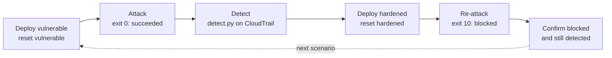
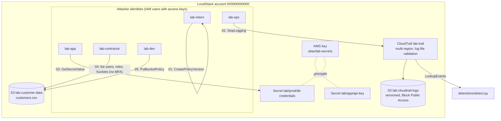

# aws-security-lab

**Attack, detect and harden AWS on your laptop.**

Every scenario ships with the exploit, the detection, the fix, and a script that proves it. Runs on [LocalStack](https://docs.localstack.cloud/), so there is no AWS bill and no real account at risk.

[](LICENSE)
[](https://developer.hashicorp.com/terraform)
[](detections/detect.py)
[](https://docs.localstack.cloud/)
[](#scenario-catalog)

<!-- TODO: demo GIF at docs/assets/demo.gif -->

## Why this exists

Learning cloud attack and defense on a real AWS account is risky and costs money, and a misconfigured lab can leak real credentials. Most labs also stop at the exploit: you get a shell, and nobody asks whether it would have been seen or how to prevent it. This project closes the loop. Each scenario is a deliberate misconfiguration in Terraform, an attack script that abuses it, a CloudTrail-based detection that catches it, a hardened build that blocks it, and a validation run that proves the fix holds and the attempt is still detected.

## Features

- **Five attack scenarios** against one LocalStack account, each mapped to MITRE ATT&CK: IAM privilege escalation, CloudTrail tampering, Secrets Manager theft, valid account without MFA, and public bucket exfiltration.
- **One Terraform variable flips every scenario.** `lab_mode=vulnerable` or `lab_mode=hardened` deploys the same resources with the same names, so the only difference between a successful and a blocked attack is the control under test.
- **Deterministic attack outcomes.** Each attack script exits `0` (`RESULT: ATTACK SUCCEEDED`) or `10` (`RESULT: ATTACK BLOCKED`), and `validate` checks every outcome against the deployed mode.
- **CloudTrail detection engine** (`detections/detect.py`) with eight rules, `LAB-001` to `LAB-008`. It keeps failed attempts and correlates denial bursts, so a blocked attack still produces a finding.
- **IAM enforcement preflight** that refuses to run the lab when LocalStack is not enforcing policies, because every result would be meaningless.
- **Windows and Unix parity.** Every base lab script exists in PowerShell (`windows/`) and bash (`attacks/`, `scripts/`).
- **Six-account enterprise landing zone** (`enterprise/`) with SCPs, an MFA-gated identity hub, Object-Locked logs, per-class KMS keys, a detector Lambda (`ENT-001` to `ENT-008`) with automatic containment, and tests that score nine attacks as prevented, detected, both, or missed.

## How it works



The base lab in `terraform/` builds a single account (`000000000000`):



The landing zone has its own architecture diagram in [`enterprise/README.md`](enterprise/README.md).

## Scenario catalog

| ID | Scenario | ATT&CK | Root-cause misconfiguration | Detection | Fix (hardened mode) |
|----|----------|--------|-----------------------------|-----------|---------------------|
| 01 | IAM privilege escalation via `iam:CreatePolicyVersion` | [T1098.003](https://attack.mitre.org/techniques/T1098/003/) (recon: [T1580](https://attack.mitre.org/techniques/T1580/)) | `lab-intern` may "maintain their own policy", so can write a default version granting `*:*` | `LAB-001`, `LAB-002` | Self-read only, plus a permissions boundary denying IAM writes |
| 02 | Defense evasion by stopping CloudTrail | [T1562.008](https://attack.mitre.org/techniques/T1562/008/) | `lab-ops` holds `cloudtrail:*` "to manage trails" | `LAB-003` | Read-only CloudTrail actions plus an explicit deny on `StopLogging`, `DeleteTrail`, `UpdateTrail`, `Put*Selectors` |
| 03 | Credential theft from Secrets Manager | [T1555.006](https://attack.mitre.org/techniques/T1555/006/) | `lab-app` can list, read and decrypt every secret | `LAB-004`, `LAB-005` | `GetSecretValue` on its own secret only, `kms:Decrypt` only via Secrets Manager (`kms:ViaService`) |
| 04 | Valid account without MFA | [T1078.004](https://attack.mitre.org/techniques/T1078/004/) | `lab-contractor` has a console password and access key, and no policy requires MFA | `LAB-007`, `LAB-006` | Deny everything except MFA self-service when `aws:MultiFactorAuthPresent` is false (`BoolIfExists`) |
| 05 | Public bucket and data exfiltration | [T1530](https://attack.mitre.org/techniques/T1530/) | `lab-dev` holds `s3:*` on the customer-data bucket and Block Public Access is off | `LAB-008`, `LAB-006` | Block Public Access on, plus a deny on bucket policy, ACL and Block Public Access changes |

`LAB-006` is a cross-scenario correlation rule: three or more `AccessDenied` calls from one identity. In hardened mode it is how you still see the attack you blocked. Scenario 04 is modeled on Stratus Red Team [`console-login-without-mfa`](https://stratus-red-team.cloud/attack-techniques/AWS/aws.initial-access.console-login-without-mfa/); see [Limitations](#limitations) for why `LAB-007` is proven from a sample event.

The ATT&CK badge counts the distinct technique IDs that a detection rule in this repo maps to: the six above, plus T1098, T1562.007 and T1485 from the landing zone detector.

## Quickstart

You need Docker, [`lstk`](https://docs.localstack.cloud/) (the LocalStack CLI) with a LocalStack account, [Terraform](https://developer.hashicorp.com/terraform/install) 1.5+ or OpenTofu, [AWS CLI v2](https://docs.aws.amazon.com/cli/latest/userguide/getting-started-install.html) 2.13+, and Python 3 with `boto3`. The bash scripts also need `jq` and `curl`.

> [!WARNING]
> AWS CLI releases older than 2.13 ignore `AWS_ENDPOINT_URL`, which every script relies on. With an old CLI, commands go to real AWS instead of LocalStack.

### Turn on IAM enforcement

> [!IMPORTANT]
> LocalStack does not enforce IAM policies by default. Without `ENFORCE_IAM=1`, every attack succeeds in both modes and the lab proves nothing. The preflight scripts check this and fail with `IAM enforcement is OFF`.

Set it through an lstk environment profile. Find the config file with `lstk config path`, then add:

```toml
[[containers]]
type = "aws"
env  = ["lab"]

[env.lab]
ENFORCE_IAM = "1"
```

Restart LocalStack afterwards (`lstk restart`). A restart clears LocalStack's in-memory state, so deploy after it.

### Windows (PowerShell 5.1 or 7)

```powershell
lstk login
lstk start
Set-ExecutionPolicy -Scope Process -ExecutionPolicy Bypass
.\windows\reset.ps1 vulnerable
.\windows\validate.ps1
.\windows\reset.ps1 hardened
.\windows\validate.ps1
```

<details>
<summary>Windows install with winget</summary>

```powershell
winget install --id Docker.DockerDesktop --exact
winget install --id OpenJS.NodeJS.LTS --exact
winget install --id Hashicorp.Terraform --exact
winget install --id Amazon.AWSCLI --exact
winget install --id Python.Python.3.14 --exact
npm install -g @localstack/lstk
py -m pip install boto3
```

Open a new PowerShell window afterwards so the new commands are on your `PATH`.

</details>

### macOS / Linux / WSL2 (bash)

```bash
lstk login
lstk start
chmod +x attacks/*.sh scripts/*.sh
scripts/reset.sh vulnerable
scripts/validate.sh
scripts/reset.sh hardened
scripts/validate.sh
```

Set `TF_BIN=tofu` to use OpenTofu.

### What `validate` does

`validate` runs preflight (LocalStack reachable, Terraform applied, `LookupEvents` working, IAM enforced), then all five attacks with CloudTrail tampering last so it cannot hide the others, then `detect.py` over the run window. It exits `0` only when every attack matches the mode: all succeed in `vulnerable`, all are blocked in `hardened`. Check that each scenario also produced at least one finding.

Run a single scenario with `windows\0N_*.ps1` or `attacks/0N_*.sh`. `reset` also re-enables CloudTrail logging, deletes leftover policy versions from scenario 01 (IAM keeps at most five), and removes the bucket policy scenario 05 publishes.

## Example output

Scenario 03 in `vulnerable` mode. This is illustrative: it follows the exact messages in `attacks/03_secrets_theft.sh`, with the access key masked. The script itself masks the stolen password.

```text
[*] Now acting as lab-app (LKIA****************)
[*] Step 1: Legitimate access to my own secret (should always work)
lab/app/api-key
[*] Step 2: Enumerate other secrets
[+] ListSecrets allowed: lab/app/api-key	lab/prod/db-credentials
[*] Step 3: Try to read every secret that isn't mine
[-] Read lab/prod/db-credentials: {"host":"prod-db.internal.example","password":"FLAG{prod****","username":"prod_admin"}
[-] RESULT: ATTACK SUCCEEDED
```

Detection output, real and trimmed, from `python3 detections/detect.py --events-file tests/sample_events.json`. The second finding is a blocked attack that still surfaces:

```text
Analyzed 15 CloudTrail events. Findings: 12

[HIGH] LAB-004 Secret read outside allowlist
    principal : lab-app
    event     : GetSecretValue at 2026-11-16T18:03:00Z
    ATT&CK    : T1555.006 Credentials from Password Stores: Cloud Secrets Management Stores
    detail    : lab-app requested lab/prod/db-credentials

[MEDIUM] LAB-006 Repeated access denied (probable blocked attack)
    principal : lab-intern
    event     : AttachUserPolicy,CreatePolicyVersion,ListSecrets at 2026-11-16T18:08:00Z
    ATT&CK    : TA0004 Privilege Escalation / TA0006 Credential Access (attempted)
    detail    : 3 denied calls: AttachUserPolicy, CreatePolicyVersion, ListSecrets
```

## Detection engine

`detections/detect.py` reads CloudTrail events from the [`LookupEvents`](https://docs.aws.amazon.com/awscloudtrail/latest/APIReference/API_LookupEvents.html) API, or from a JSON file in either CloudTrail log format (`{"Records": [...]}`) or `LookupEvents` format (entries with a `CloudTrailEvent` string). It is the lab's stand-in for managed detection, which LocalStack does not emulate.

| Rule | Severity | Fires on |
|------|----------|----------|
| `LAB-001` | HIGH | `CreatePolicyVersion` with `setAsDefault`, or `SetDefaultPolicyVersion` |
| `LAB-002` | HIGH | `AdministratorAccess` attached to a user, role or group |
| `LAB-003` | CRITICAL | `StopLogging`, `DeleteTrail`, `UpdateTrail`, `PutEventSelectors`, `PutInsightSelectors` |
| `LAB-004` | HIGH | `GetSecretValue` on a secret outside the caller's allowlist (root excluded) |
| `LAB-005` | MEDIUM | `ListSecrets` by a non-root identity |
| `LAB-006` | MEDIUM | Three or more denied calls from one identity |
| `LAB-007` | HIGH | Successful `ConsoleLogin` with `MFAUsed` = `No` |
| `LAB-008` | HIGH | `DeletePublicAccessBlock`, `DeleteBucketPolicy`, a public or unreadable `PutBucketPolicy`, or a public ACL |

Rules that match a failed call are still reported, tagged `[attempt failed: <errorCode>]`. Pass `--successful-only` to drop them.

```bash
python3 detections/detect.py                                     # LocalStack, last 60 minutes
python3 detections/detect.py --minutes 15 --json                 # machine-readable
python3 detections/detect.py --events-file tests/sample_events.json
python3 detections/detect.py --endpoint none                     # real AWS, default boto3 credentials
python3 detections/detect.py --fail-on-findings                  # exit 1 if any rule fires
python3 -m unittest discover -s tests                            # rule unit tests, offline
```

On Windows use `py` instead of `python3`. Against real AWS the caller needs `cloudtrail:LookupEvents`, which returns management events only. The secret allowlist defaults to `{"lab-app": ["lab/app/api-key"]}`; override it with `--allowlist file.json`.

**Adding a rule.** A rule is a function `(event, cfg) -> str | None` that returns a detail string when it fires. Register it in `RULES` with an ID, title, severity and ATT&CK mapping:

```python
def r_access_key_for_other_user(ev: dict, cfg: dict) -> str | None:
    if ev.get("eventName") == "CreateAccessKey":
        target = params(ev).get("userName")
        if target and target != principal(ev):
            return f"{principal(ev)} created an access key for {target}"
    return None
```

Then add a matching event to `tests/sample_events.json` and an assertion to `tests/test_detect.py`.

## Enterprise landing zone

[`enterprise/`](enterprise/) applies the same method to six accounts under one Organization: four SCPs, an MFA-gated identity hub, a CloudTrail trail per account into an Object Lock (COMPLIANCE) archive, one KMS key per data class, three-tier VPCs with no NAT, CloudFront and WAF in front of an ALB, and a detector Lambda with one containment playbook. It is PowerShell-only today.

```powershell
.\enterprise\deploy.ps1
.\enterprise\tests\security_assertions.ps1
.\enterprise\tests\attack_simulation.ps1
py -m unittest discover -s enterprise\tests
```

`security_assertions.ps1` checks each deployed control (one PASS or FAIL per assertion ID, filterable with `-Layer`). `attack_simulation.ps1` runs attacks `A1` to `A9` and scores each. Design notes: [`THREAT_MODEL.md`](enterprise/THREAT_MODEL.md) and [`COVERAGE.md`](enterprise/COVERAGE.md).

## Project structure

```text
terraform/     Base lab: shared baseline (KMS, CloudTrail, secrets) and one file per scenario
attacks/       Bash attack scripts 01-05 and shared helpers (common.sh)
scripts/       Bash reset, preflight and validate
windows/       PowerShell ports of every attack, reset, preflight and validate script
detections/    detect.py, the CloudTrail rules engine
tests/         Detection unit tests and sample CloudTrail events
enterprise/    Six-account landing zone
  modules/       organization, identity, logging, data-protection, network,
                 workload, edge, detection, cmk
  tests/         Security assertions, attack simulation, detector unit tests, coverage probe
docs/          README.previous.md (the earlier README)
```

## Limitations

- **LocalStack is not AWS.** Results show that the controls work in the emulator. Treat anything you rely on as confirmed only after a test in a real account. [`enterprise/COVERAGE.md`](enterprise/COVERAGE.md) records what was and was not observed, per service.
- **No managed detection.** GuardDuty and Security Hub are not emulated. `detect.py` and the landing zone detector replace them, and only see what CloudTrail records.
- **Policy conditions may behave differently.** In the landing zone tests, `kms:ViaService` was never the deciding control because IAM denied first, and `aws:SecureTransport` is not evaluated over `http://`. Permissions boundaries and MFA conditions can vary by LocalStack version and tier.
- **Event shapes differ.** LocalStack omits `userName` on IAM-user events and logs `PutBucketPolicy` with an empty policy, so `detect.py` derives names from the ARN and treats an unreadable policy as exposure.
- **No console sign-in.** LocalStack has no sign-in endpoint, so scenario 04 attacks with the contractor's access key and `LAB-007` is proven against a sample `ConsoleLogin` event in `tests/sample_events.json`.
- **Lab credentials live in Terraform state.** They only work inside LocalStack, and `*.tfstate` is git-ignored. Never commit it. The PowerShell scripts point the AWS CLI at config files that do not exist so `~/.aws` is never read; the bash scripts only unset `AWS_PROFILE` and `AWS_SESSION_TOKEN`, so run them in a shell without real AWS credentials or a non-LocalStack `AWS_ENDPOINT_URL`.

## Roadmap

- [x] Public S3 exfiltration scenario (`05`)
- [x] Reference enterprise architecture (`enterprise/`)
- [ ] More base scenarios: role trust policy backdoor (T1098), access key persistence (T1098.001), KMS key scheduled for deletion (T1485, already covered in the landing zone as `A8` / `ENT-006`)
- [ ] Sigma export of the `LAB` rules and an ATT&CK Navigator layer generated from them
- [ ] Cross-platform CLI replacing the paired bash and PowerShell scripts
- [ ] CI with LocalStack (unit tests on every push, `validate` in both modes) and a docs site

## Contributing

To add a base lab scenario:

1. **Terraform.** Add `terraform/scenarioN_<name>.tf` with both versions keyed on `local.vulnerable`, keeping resource names identical across modes. Add the attacker's keys to the `credentials` output and any names the scripts need to `terraform/outputs.tf`.
2. **Attack.** Add `attacks/0N_<name>.sh` and `windows/0N_<name>.ps1` that end with `finish succeeded` or `finish blocked` (`Finish` in PowerShell). Add them to the loop in `scripts/validate.sh` and `windows/validate.ps1` before `02_cloudtrail_tamper`, and clean up any state Terraform does not manage in both `reset` scripts.
3. **Detection.** Add a rule to `detections/detect.py`, sample events (one succeeded, one denied) to `tests/sample_events.json`, and a test to `tests/test_detect.py`. Run `python3 -m unittest discover -s tests`, then `validate` in both modes.

## Responsible use

Everything here targets LocalStack on `localhost`. The attacks are real techniques: use them only against systems you own or are explicitly authorized to test, and only for security testing and education. Do not point these scripts at an AWS account you do not control.

## License and author

[MIT](LICENSE). Built by Roshan ([@roshanrt](https://github.com/roshanrt)).
