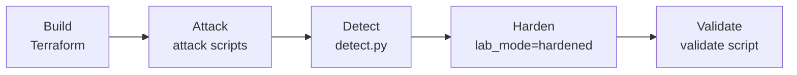

# AWS Security Lab

An attack-and-defend AWS security lab that runs entirely on your laptop with [LocalStack](https://docs.localstack.cloud/).

Deploy a deliberately vulnerable AWS environment with Terraform, attack it with real techniques, detect the attacks from CloudTrail, switch to the hardened build, and prove the fixes work by running the same attacks again.



> **Use only on systems you own.** Everything here targets LocalStack on `localhost`. The attacks are real techniques, so do not point them at an AWS account you do not control.

## Scenarios

| # | Attack | Attacker | Root cause | ATT&CK | Detection | Fix |
|---|--------|----------|------------|--------|-----------|-----|
| 1 | IAM privilege escalation with `iam:CreatePolicyVersion` | `lab-intern` | May "maintain their own policy", so can write a new default version that grants `*:*` | T1580, [T1098.003](https://attack.mitre.org/techniques/T1098/003/) | `LAB-001`, `LAB-002` | Self-read only, plus a permissions boundary that denies IAM writes |
| 2 | Defense evasion by stopping CloudTrail | `lab-ops` | Was given `cloudtrail:*` "to manage trails" | [T1562.008](https://attack.mitre.org/techniques/T1562/008/) | `LAB-003` | Read-only CloudTrail access plus an explicit deny on tampering |
| 3 | Credential theft from Secrets Manager | `lab-app` | Can read and decrypt every secret, including `lab/prod/db-credentials` | [T1555.006](https://attack.mitre.org/techniques/T1555/006/) | `LAB-004`, `LAB-005` | `GetSecretValue` on its own secret only, and `kms:Decrypt` only through Secrets Manager |

`LAB-006` is a cross-scenario rule: three or more `AccessDenied` calls from one identity. In hardened mode this is how you still see the attack you blocked.

## How it works

`terraform/` deploys a shared baseline (a KMS key, a CloudTrail trail with a protected log bucket, and two secrets) plus one file per scenario. The variable `lab_mode` switches each scenario between its two versions, with the same resources and names, so the only difference between a successful and a blocked attack is the control under test.

| Mode | What it means | `validate` expects |
|------|---------------|--------------------|
| `vulnerable` | Deliberate misconfigurations | Every attack succeeds and is detected |
| `hardened` | The fixes applied | Every attack is blocked and still detected |

Each attack script ends with `RESULT: ATTACK SUCCEEDED` (exit code 0) or `RESULT: ATTACK BLOCKED` (exit code 10).

## Requirements

- Docker Desktop (or Docker Engine), running
- [`lstk`](https://docs.localstack.cloud/), the LocalStack CLI, and a LocalStack account
- Terraform 1.5 or newer (or OpenTofu)
- AWS CLI v2, version 2.13 or newer. The scripts rely on `AWS_ENDPOINT_URL`, which older v2 releases ignore, so commands would go to real AWS.
- Python 3 with `boto3`
- Windows PowerShell 5.1 or PowerShell 7. The bash scripts need WSL2 or Git Bash plus `jq` and `curl`.

Windows install:

```powershell
winget install --id Docker.DockerDesktop --exact
winget install --id OpenJS.NodeJS.LTS --exact
winget install --id Hashicorp.Terraform --exact
winget install --id Amazon.AWSCLI --exact
winget install --id Python.Python.3.14 --exact
npm install -g @localstack/lstk
py -m pip install boto3
```

Open a new PowerShell window afterwards so the new commands are on your `PATH`.

## Quick start

### 1. Start LocalStack

```powershell
lstk login
lstk start
lstk status
```

### 2. Turn on IAM enforcement (required)

LocalStack does not enforce IAM policies by default. Without enforcement every attack succeeds in both modes and the lab proves nothing. Set `ENFORCE_IAM=1` through an lstk environment profile. Find the config file with `lstk config path`, then:

```toml
[[containers]]
type = "aws"
env  = ["lab"]

[env.lab]
ENFORCE_IAM = "1"
```

```powershell
lstk restart
```

Restarting clears LocalStack's in-memory state, so deploy the lab after it.

### 3. Deploy and check

```powershell
Set-ExecutionPolicy -Scope Process -ExecutionPolicy Bypass
.\windows\reset.ps1 vulnerable
.\windows\preflight.ps1
```

Preflight checks that LocalStack is reachable, Terraform has deployed, CloudTrail `LookupEvents` returns data, and IAM is really enforced (it makes `lab-app` try `iam:CreateUser`, which no mode allows). A good run looks like this:

```text
[*] LocalStack health at http://localhost:4566
[+] LocalStack is reachable
[*] Terraform outputs
[+] Lab deployed in 'vulnerable' mode
[*] CloudTrail event history (needed by detections\detect.py)
[+] LookupEvents works
[*] IAM enforcement probe: lab-app tries iam:CreateUser (never allowed in either mode)
[*] Now acting as lab-app (LKIA****)
[+] IAM enforcement is ON
[+] Preflight passed
```

If it prints `IAM enforcement is OFF`, fix step 2 before going on.

## Run the lab

### Attack the vulnerable build

```powershell
.\windows\validate.ps1
```

This runs preflight, all three attacks (CloudTrail tampering last, so it cannot hide the other two), and the detections. Every attack should succeed and be detected. You can also run one attack at a time:

```powershell
.\windows\01_iam_privesc.ps1
.\windows\03_secrets_theft.ps1
.\windows\02_cloudtrail_tamper.ps1      # run last: it stops logging
py detections\detect.py --minutes 15
```

### Harden and prove it

```powershell
.\windows\reset.ps1 hardened
.\windows\validate.ps1
```

Every attack should now be blocked. A good result is a blocked attack that still shows up as a finding, such as a failed `LAB-001` attempt or a `LAB-006` denial burst. Prevention nobody sees is a control you cannot monitor.

### Reset at any time

```powershell
.\windows\reset.ps1 vulnerable      # or hardened
```

The reset also re-enables CloudTrail logging and deletes leftover IAM policy versions from scenario 1 (IAM keeps at most five).

## Detection engine

`detections/detect.py` reads CloudTrail events and applies rules mapped to MITRE ATT&CK. It is the local stand-in for managed detection, which LocalStack does not emulate, and it also works on real AWS event history.

| Rule | Severity | Fires on |
|------|----------|----------|
| `LAB-001` | HIGH | `CreatePolicyVersion` with `setAsDefault`, or `SetDefaultPolicyVersion` |
| `LAB-002` | HIGH | `AdministratorAccess` attached |
| `LAB-003` | CRITICAL | `StopLogging`, `DeleteTrail`, `UpdateTrail`, `PutEventSelectors` |
| `LAB-004` | HIGH | `GetSecretValue` on a secret outside the caller's allowlist |
| `LAB-005` | MEDIUM | `ListSecrets` enumeration |
| `LAB-006` | MEDIUM | Three or more denied calls from one identity |

```powershell
py detections\detect.py                         # last 60 minutes from LocalStack
py detections\detect.py --minutes 15
py detections\detect.py --json                  # machine-readable
py detections\detect.py --successful-only       # ignore failed attempts
py detections\detect.py --fail-on-findings      # exit 1 if anything fires (CI)
py detections\detect.py --events-file export.json
py detections\detect.py --endpoint none         # real AWS, default credentials
py -m unittest discover -s tests                # rule unit tests
```

The default allowlist lets `lab-app` read only `lab/app/api-key`. To change it, pass `--allowlist allowlist.json`:

```json
{ "lab-app": ["lab/app/api-key"] }
```

## Repository layout

```text
terraform/     Baseline (KMS, CloudTrail, secrets) and one file per scenario
windows/       PowerShell: reset, preflight, validate, and one script per attack
attacks/       Bash version of the attack scripts, plus shared helpers
scripts/       Bash version of reset, preflight and validate
detections/    detect.py: CloudTrail rules mapped to MITRE ATT&CK
tests/         Unit tests for the detection rules
```

<details>
<summary>Using the bash scripts instead (WSL2, Git Bash, Linux, macOS)</summary>

```bash
chmod +x attacks/*.sh scripts/*.sh
scripts/reset.sh vulnerable
scripts/preflight.sh
attacks/01_iam_privesc.sh
attacks/03_secrets_theft.sh
attacks/02_cloudtrail_tamper.sh     # run last: it stops logging
python3 detections/detect.py --minutes 15
scripts/reset.sh hardened
scripts/validate.sh
```

Set `TF_BIN=tofu` to use OpenTofu.

</details>

## Limitations

- **Emulator fidelity.** LocalStack does not reproduce every AWS behavior. Policy conditions such as `kms:ViaService`, permissions boundaries and CloudTrail event shapes may differ from real AWS depending on version and tier. Treat a result you rely on as confirmed only after a test in a real account.
- **No managed detection.** GuardDuty and Security Hub are not emulated. `detect.py` is the stand-in.
- **Lab credentials.** The Terraform state holds the lab users' access keys. They only work inside LocalStack, but never commit state files. The scripts point the AWS CLI at files that do not exist, so your real `~/.aws` is never read. Those variables stay set in the PowerShell window you ran them from, so open a new window before using real AWS.

## Ideas for next scenarios

- Role trust policy backdoor (`UpdateAssumeRolePolicy`), T1098
- Access key persistence (`CreateAccessKey` for another user), T1098.001
- Public S3 bucket and data exfiltration, T1530
- KMS key scheduled for deletion, T1485
- Lambda environment variable secret exposure, T1552.001
