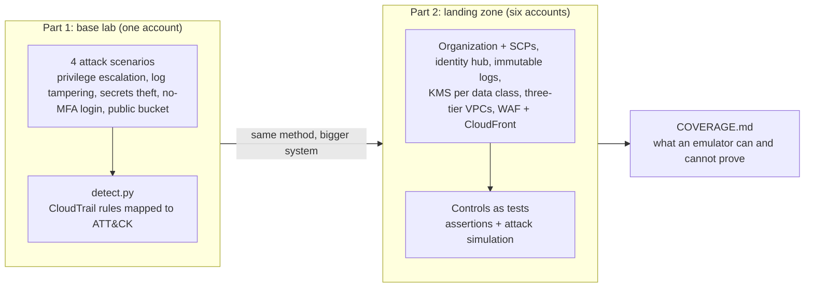

# Attack, Detect, Harden: an AWS security lab on LocalStack

Learn cloud security by breaking it. This project builds a deliberately vulnerable AWS environment on your laptop, attacks it with real techniques, detects the attacks from CloudTrail, fixes the Terraform, and proves the fixes by running the same attacks again. Then it scales the same method up to a multi-account landing zone whose controls are tested like code.

It runs entirely on [LocalStack](https://docs.localstack.cloud/). There is no AWS bill and no real account at risk, and a reset puts everything back in seconds.

I am a security professional (AppSec and red team background) moving into cloud security architecture. The aim is to get from "I know how attackers think" to "I can design and prove a secure AWS architecture", and to write down what I learn on the way.

> **Use only on systems you own.** Everything here targets LocalStack on `localhost`. The attacks are real techniques, so do not point them at an AWS account you do not control.

## The whole picture



| Part | What it is | Where |
|------|------------|-------|
| **1. Base lab** | One account, five attacks, each with a vulnerable and a hardened build, plus a detection engine | `terraform/`, `windows/`, `attacks/`, `scripts/`, `detections/`, `tests/` |
| **2. Enterprise landing zone** | Six accounts under an Organization: SCPs, MFA-gated identity hub, Object-Locked log archive, one KMS key per data class, three-tier VPCs, edge protection, an automated detection and containment pipeline | [`enterprise/`](enterprise/) |
| **3. Honesty about the emulator** | A written list of what LocalStack proves, what it only configures, and what must be checked on real AWS | [`enterprise/COVERAGE.md`](enterprise/COVERAGE.md) |

Three ideas run through all of it:

- **Attack first.** Every control exists because an attack needed it. Each fix is proven by an attack that fails afterwards.
- **Detection as code.** Rules are mapped to MITRE ATT&CK, unit-tested offline, and still fire on attacks that were blocked, because a blocked attack nobody sees is a control you cannot monitor.
- **Controls as tests.** Each control has a test that reads the deployed configuration, and an attack simulation scores every attack as prevented, detected, both, or missed.

## Blog series

The code follows a companion series, "Attack, Detect, Harden: Building a Secure AWS Architecture on LocalStack". Each post gets a git tag (`post-01`, `post-02`, ...) so you can check out the code as it was when the post was written.

| # | Post | Where it lives in this repo | ATT&CK |
|---|------|-----------------------------|--------|
| 1 | Your free cloud security lab (LocalStack and `lstk` on Windows, the IAM enforcement trap) | `windows/preflight.ps1`, this README | |
| 2 | Threat model first | [`enterprise/THREAT_MODEL.md`](enterprise/THREAT_MODEL.md) | |
| 3 | IAM privilege escalation with one API call | `terraform/scenario1_iam_privesc.tf`, `windows/01_iam_privesc.ps1` | T1098.003 |
| 4 | Stealing secrets from Secrets Manager | `terraform/scenario3_secrets_theft.tf`, `windows/03_secrets_theft.ps1` | T1555.006 |
| 5 | Blinding CloudTrail | `terraform/scenario2_cloudtrail_tamper.tf`, `windows/02_cloudtrail_tamper.ps1` | T1562.008 |
| 6 | Building GuardDuty-lite: a detection engine | `detections/detect.py`, `tests/` | |
| 7 | A multi-account landing zone on a laptop | `enterprise/modules/organization`, `identity`, `logging` | |
| 8 | Network segmentation you can prove | `enterprise/modules/network`, `edge` | |
| 9 | Data protection and ransomware resilience | `enterprise/modules/data-protection`, `cmk`, `workload` | |
| 10 | Controls as tests | `enterprise/tests/` | |
| 11 | What an emulator cannot tell you | [`enterprise/COVERAGE.md`](enterprise/COVERAGE.md) | |

Not every post is written yet. The code for all of them is already here.

## Part 1: the base lab

### Scenarios

| # | Attack | Attacker | Root cause | ATT&CK | Detection | Fix |
|---|--------|----------|------------|--------|-----------|-----|
| 1 | IAM privilege escalation with `iam:CreatePolicyVersion` | `lab-intern` | May "maintain their own policy", so can write a new default version that grants `*:*` | T1580, [T1098.003](https://attack.mitre.org/techniques/T1098/003/) | `LAB-001`, `LAB-002` | Self-read only, plus a permissions boundary that denies IAM writes |
| 2 | Defense evasion by stopping CloudTrail | `lab-ops` | Was given `cloudtrail:*` "to manage trails" | [T1562.008](https://attack.mitre.org/techniques/T1562/008/) | `LAB-003` | Read-only CloudTrail access plus an explicit deny on tampering |
| 3 | Credential theft from Secrets Manager | `lab-app` | Can read and decrypt every secret, including `lab/prod/db-credentials` | [T1555.006](https://attack.mitre.org/techniques/T1555/006/) | `LAB-004`, `LAB-005` | `GetSecretValue` on its own secret only, and `kms:Decrypt` only through Secrets Manager |
| 4 | Valid account without MFA (console password or stolen key), modeled on Stratus Red Team [`console-login-without-mfa`](https://stratus-red-team.cloud/attack-techniques/AWS/aws.initial-access.console-login-without-mfa/) | `lab-contractor` | Console password and access key, no MFA, and a policy that never requires it | [T1078.004](https://attack.mitre.org/techniques/T1078/004/) | `LAB-007`, `LAB-006` | Explicit deny on everything except MFA self-service when `aws:MultiFactorAuthPresent` is false |
| 5 | Public bucket and data exfiltration | `lab-dev` | Holds `s3:*` on the customer-data bucket and Block Public Access is off, so one policy publishes it and anyone reads it | [T1530](https://attack.mitre.org/techniques/T1530/) | `LAB-008`, `LAB-006` | Block Public Access on, and an explicit deny on policy, ACL and Block Public Access changes |

Scenario 4 caveat: LocalStack has no sign-in endpoint, so the attack script uses the contractor's access key (the same deny policy covers the console) and `LAB-007` is proven against a sample `ConsoleLogin` event in `tests/sample_events.json`.

`LAB-006` is a cross-scenario rule: three or more `AccessDenied` calls from one identity. In hardened mode this is how you still see the attack you blocked.

`terraform/` deploys a shared baseline (a KMS key, a CloudTrail trail with a protected log bucket, and two secrets) plus one file per scenario. The variable `lab_mode` switches each scenario between its two versions, with the same resources and names, so the only difference between a successful and a blocked attack is the control under test.

| Mode | What it means | `validate` expects |
|------|---------------|--------------------|
| `vulnerable` | Deliberate misconfigurations | Every attack succeeds and is detected |
| `hardened` | The fixes applied | Every attack is blocked and still detected |

Each attack script ends with `RESULT: ATTACK SUCCEEDED` (exit code 0) or `RESULT: ATTACK BLOCKED` (exit code 10).

### Detection engine

`detections/detect.py` reads CloudTrail events and applies rules mapped to MITRE ATT&CK. It is the local stand-in for managed detection, which LocalStack does not emulate, and it also works on real AWS event history.

| Rule | Severity | Fires on |
|------|----------|----------|
| `LAB-001` | HIGH | `CreatePolicyVersion` with `setAsDefault`, or `SetDefaultPolicyVersion` |
| `LAB-002` | HIGH | `AdministratorAccess` attached |
| `LAB-003` | CRITICAL | `StopLogging`, `DeleteTrail`, `UpdateTrail`, `PutEventSelectors` |
| `LAB-004` | HIGH | `GetSecretValue` on a secret outside the caller's allowlist |
| `LAB-005` | MEDIUM | `ListSecrets` enumeration |
| `LAB-007` | HIGH | `ConsoleLogin` success with `MFAUsed` = `No` |
| `LAB-008` | HIGH | `DeletePublicAccessBlock`, `DeleteBucketPolicy`, a `PutBucketPolicy` that is public or unreadable, or a public ACL |
| `LAB-006` | MEDIUM | Three or more denied calls from one identity |

```powershell
py detections\detect.py                         # last 60 minutes from LocalStack
py detections\detect.py --minutes 15
py detections\detect.py --json                  # machine-readable
py detections\detect.py --successful-only       # ignore failed attempts
py detections\detect.py --fail-on-findings      # exit 1 if anything fires (CI)
py detections\detect.py --events-file export.json
py detections\detect.py --endpoint none         # real AWS, default credentials
py -m unittest discover -s tests                # rule unit tests
```

The default allowlist lets `lab-app` read only `lab/app/api-key`. To change it, pass `--allowlist allowlist.json`:

```json
{ "lab-app": ["lab/app/api-key"] }
```

## Part 2: the enterprise landing zone

Six accounts under one Organization, deployed with Terraform and tested end to end. The full architecture diagram, account table, control-to-test mapping and deploy steps are in [`enterprise/README.md`](enterprise/README.md).

| Layer | What it builds | Why |
|-------|----------------|-----|
| Organization | OUs and four SCPs (no CloudTrail tampering, no leaving the org, approved regions only, no IAM users or access keys) | SCPs bind even the account root |
| Identity | MFA-gated human roles, machine roles pinned to one principal, a guardrail permissions boundary on every role | No long-lived keys to steal, and a compromised pipeline cannot grant itself more |
| Logging | A CloudTrail trail per account into an Object Lock (COMPLIANCE) archive in a separate account | An attacker with admin cannot rewrite history |
| Data protection | One KMS key per data class with admin and use separated, AWS Backup with a second vault | Losing a key loses the data, using a key reads it |
| Network and edge | Three-tier VPCs with no NAT, security groups chained by ID, VPC endpoints, flow logs, CloudFront and WAF in front of an ALB | Segmentation you can prove from configuration |
| Workload | Lambda, RDS, DynamoDB, S3 and Secrets Manager with least-privilege access | Something real to protect |
| Detection | A detector Lambda with eight rules (`ENT-001` to `ENT-008`) and one automatic containment playbook that closes a security group opened to the internet | Detect, alert and respond |

It is tested two ways:

- `enterprise/tests/security_assertions.ps1` checks the deployed configuration, one PASS or FAIL per control.
- `enterprise/tests/attack_simulation.ps1` runs nine attacks (`A1` to `A9`) and scores each as prevented, detected, both, or missed.

Latest attack simulation on a fresh deploy: 9 attacks, none missed.

| Outcome | Attacks |
|---------|---------|
| Prevented (call refused) | A1 and A2 (stop CloudTrail, as the pipeline role and as account root) |
| Both prevented and reported | A4 (attach AdministratorAccess), A5 (unbounded role), A6 (read the database secret), A8 (schedule key deletion), A9 (break-glass without MFA) |
| Detected, then contained | A3 (security group opened to the internet): the detector found it and closed it again |
| Detected | A7 (public bucket policy): the call succeeds, and the detector reports it |

A7 is an honest gap: the pipeline role can still replace the data bucket's policy, and the system detects it rather than preventing it. Closing that is on the roadmap.

Design docs:

- [`enterprise/THREAT_MODEL.md`](enterprise/THREAT_MODEL.md): assets, trust boundaries, the top ten threats, and the control and test for each.
- [`enterprise/COVERAGE.md`](enterprise/COVERAGE.md): what LocalStack could and could not prove, and what each skipped control needs on real AWS.

## Requirements

- Docker Desktop (or Docker Engine), running
- [`lstk`](https://docs.localstack.cloud/), the LocalStack CLI, and a LocalStack account. The landing zone uses RDS, Organizations and IAM enforcement, so check your plan includes them.
- Terraform 1.5 or newer (or OpenTofu)
- AWS CLI v2, version 2.13 or newer. The scripts rely on `AWS_ENDPOINT_URL`, which older v2 releases ignore, so commands would go to real AWS.
- Python 3 with `boto3`
- Windows PowerShell 5.1 or PowerShell 7. The base lab also has bash scripts, which need WSL2 or Git Bash plus `jq` and `curl`.

Windows install:

```powershell
winget install --id Docker.DockerDesktop --exact
winget install --id OpenJS.NodeJS.LTS --exact
winget install --id Hashicorp.Terraform --exact
winget install --id Amazon.AWSCLI --exact
winget install --id Python.Python.3.14 --exact
npm install -g @localstack/lstk
py -m pip install boto3
```

Open a new PowerShell window afterwards so the new commands are on your `PATH`.

## Quick start

### 1. Start LocalStack

```powershell
lstk login
lstk start
lstk status
```

### 2. Turn on IAM enforcement (required)

LocalStack does not enforce IAM policies by default. Without enforcement every attack succeeds in both modes and the lab proves nothing. Set `ENFORCE_IAM=1` through an lstk environment profile. Find the config file with `lstk config path`, then:

```toml
[[containers]]
type = "aws"
env  = ["lab"]

[env.lab]
ENFORCE_IAM = "1"
```

```powershell
lstk restart
```

Restarting clears LocalStack's in-memory state, so deploy after it.

### 3. Deploy the base lab and check it

```powershell
Set-ExecutionPolicy -Scope Process -ExecutionPolicy Bypass
.\windows\reset.ps1 vulnerable
.\windows\preflight.ps1
```

Preflight checks that LocalStack is reachable, Terraform has deployed, CloudTrail `LookupEvents` returns data, and IAM is really enforced (it makes `lab-app` try `iam:CreateUser`, which no mode allows). A good run looks like this:

```text
[*] LocalStack health at http://localhost:4566
[+] LocalStack is reachable
[*] Terraform outputs
[+] Lab deployed in 'vulnerable' mode
[*] CloudTrail event history (needed by detections\detect.py)
[+] LookupEvents works
[*] IAM enforcement probe: lab-app tries iam:CreateUser (never allowed in either mode)
[*] Now acting as lab-app (LKIA****)
[+] IAM enforcement is ON
[+] Preflight passed
```

If it prints `IAM enforcement is OFF`, fix step 2 before going on.

### 4. Attack, detect, harden, validate

```powershell
.\windows\validate.ps1              # vulnerable: every attack should succeed and be detected
.\windows\reset.ps1 hardened
.\windows\validate.ps1              # hardened: every attack should be blocked and still detected
```

`validate.ps1` runs preflight, all five attacks (CloudTrail tampering last, so it cannot hide the other two), and then the detections. You can also run one attack at a time:

```powershell
.\windows\01_iam_privesc.ps1
.\windows\03_secrets_theft.ps1
.\windows\04_no_mfa.ps1
.\windows\05_public_bucket.ps1
.\windows\02_cloudtrail_tamper.ps1      # run last: it stops logging
py detections\detect.py --minutes 15
```

A good hardened result is a blocked attack that still shows up as a finding, such as a failed `LAB-001` attempt or a `LAB-006` denial burst.

Reset at any time with `.\windows\reset.ps1 vulnerable` or `hardened`. It also re-enables CloudTrail logging and deletes leftover IAM policy versions from scenario 1 (IAM keeps at most five).

### 5. Deploy the landing zone

```powershell
.\enterprise\deploy.ps1                          # about 10 minutes
.\enterprise\tests\security_assertions.ps1       # about 15 minutes
.\enterprise\tests\attack_simulation.ps1         # about 8 minutes
py -m unittest discover -s enterprise\tests      # offline rule tests, instant
```

More in [`enterprise/README.md`](enterprise/README.md), including per-layer test runs and teardown.

<details>
<summary>Using the bash scripts for the base lab (WSL2, Git Bash, Linux, macOS)</summary>

```bash
chmod +x attacks/*.sh scripts/*.sh
scripts/reset.sh vulnerable
scripts/preflight.sh
attacks/01_iam_privesc.sh
attacks/03_secrets_theft.sh
attacks/04_no_mfa.sh
attacks/05_public_bucket.sh
attacks/02_cloudtrail_tamper.sh     # run last: it stops logging
python3 detections/detect.py --minutes 15
scripts/reset.sh hardened
scripts/validate.sh
```

Set `TF_BIN=tofu` to use OpenTofu.

</details>

## Repository layout

```text
terraform/     Part 1: baseline (KMS, CloudTrail, secrets) and one file per scenario
windows/       Part 1: PowerShell reset, preflight, validate, and one script per attack
attacks/       Part 1: bash version of the attack scripts, plus shared helpers
scripts/       Part 1: bash version of reset, preflight and validate
detections/    Part 1: detect.py, CloudTrail rules mapped to MITRE ATT&CK
tests/         Part 1: unit tests for the detection rules
enterprise/    Part 2: the landing zone
  modules/       organization, identity, logging, data-protection, network,
                 workload, edge, detection, cmk
  tests/         security assertions, attack simulation, detector unit tests
  THREAT_MODEL.md, COVERAGE.md
```

## Limitations

- **Emulator fidelity.** LocalStack does not reproduce every AWS behavior. Policy conditions such as `kms:ViaService`, permissions boundaries and CloudTrail event shapes may differ from real AWS depending on version and tier. Network filtering, WAF inspection and Backup Vault Lock are not emulated. Treat a result you rely on as confirmed only after a test in a real account. [`enterprise/COVERAGE.md`](enterprise/COVERAGE.md) lists every gap.
- **No managed detection.** GuardDuty and Security Hub are not emulated. `detect.py` and the landing zone detector are the stand-ins.
- **Lab credentials.** Terraform state holds lab access keys and passwords. They only work inside LocalStack, but never commit state files. The scripts point the AWS CLI at files that do not exist, so your real `~/.aws` is never read. Those variables stay set in the PowerShell window you ran them from, so open a new window before using real AWS.

## Roadmap

1. **Prevent public bucket policies.** Deny `s3:PutBucketPolicy` and `s3:DeleteBucketPolicy` for everyone except the deployer, so A7 is blocked instead of only detected.
2. **Request logging and rotation.** WAF, ALB and CloudFront logs to the log archive, CloudTrail S3 data events, and a Secrets Manager rotation Lambda.
3. **Run it on a real AWS organization.** Replace the bootstrap user with IAM Identity Center and CI OIDC, replace root with a deploy role, and work through the "verify on real AWS" column in `COVERAGE.md`.
4. **Watch the watcher.** A heartbeat alarm when the detector stops, an organization trail, root-activity findings, and a second containment playbook.
5. **More base scenarios.** Role trust policy backdoor (`UpdateAssumeRolePolicy`, T1098), access key persistence (`CreateAccessKey` for another user, T1098.001), KMS key scheduled for deletion (T1485), Lambda environment variable secrets (T1552.001).
