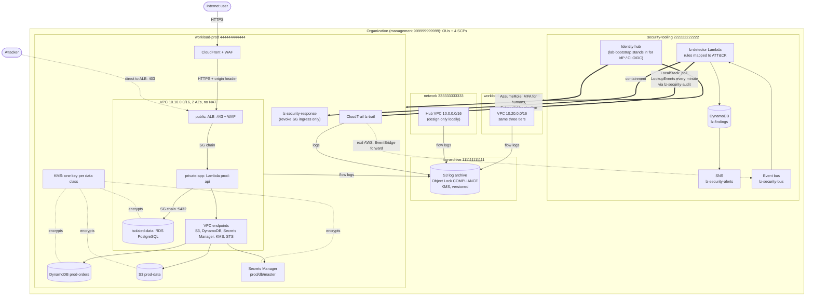

# Enterprise landing zone on LocalStack

A multi-account AWS security architecture as Terraform, deployed to LocalStack from
PowerShell, with tests that prove each control: assertions that read the deployed
configuration, and an attack simulation that tries to break it.

It sits next to the base lab (`terraform\`, `windows\`, `detections\`) and does not
change it. The base lab lives in account `000000000000`; this uses six other accounts.

- `COVERAGE.md`: what LocalStack can and cannot prove, and every substitution
- `THREAT_MODEL.md`: trust boundaries, top 10 threats, control and test for each

## Architecture



Solid arrows are data and request paths, thick arrows are role assumptions, dotted
arrows are the real-AWS event path that LocalStack cannot deliver across accounts.

### Accounts

| Account | ID | Holds |
|---|---|---|
| org-management | 999999999999 | Organization, OUs (Security, Infrastructure, Workloads/Prod, Workloads/NonProd), 4 SCPs, SCP canary account |
| log-archive | 111111111111 | Immutable log bucket, logs KMS key |
| security-tooling | 222222222222 | Identity hub, detector Lambda, findings table, alert topic, security event bus |
| network | 333333333333 | Shared hub VPC |
| workload-prod | 444444444444 | Three-tier VPC, edge, application, RDS, DynamoDB, S3, secret, 5 data keys, backups |
| workload-nonprod | 555555555555 | Three-tier VPC, identity baseline |

### Layout

```
enterprise\
  providers.tf, main.tf, variables.tf, outputs.tf   root: 6 provider aliases, one module call per layer
  modules\
    organization\      OUs and SCPs
    identity\          roles, boundaries, account baseline (one instance per account)
    logging\           immutable buckets, logs key, one trail per account
    data-protection\   KMS key per data class, AWS Backup
    network\           three-tier VPC, security group chain, endpoints, flow logs
    workload\          Lambda, RDS, DynamoDB, S3, Secrets Manager
    edge\              CloudFront, WAFv2, ALB
    detection\         detector Lambda, findings, alerts, containment
    cmk\               helper: one KMS key with admin/use separation
  tests\
    security_assertions.ps1   one PASS/FAIL per control
    attack_simulation.ps1     9 attacks: prevented / detected / both / missed
    test_detector.py          offline unit tests for the detection rules
    coverage_probe.ps1        the Step 0 service probe
  deploy.ps1, destroy.ps1, lib.ps1
```

## Deploy and destroy (PowerShell 5.1 or 7)

Prerequisites: Docker Desktop running, `lstk`, Terraform 1.5+, AWS CLI v2, Python (`py`).
LocalStack must run with `ENFORCE_IAM=1` (see "Turn on IAM enforcement" in the main `..\README.md`).

```powershell
Set-ExecutionPolicy -Scope Process -ExecutionPolicy Bypass
lstk start

.\enterprise\deploy.ps1                          # about 10 minutes
.\enterprise\tests\security_assertions.ps1       # about 15 minutes: each AWS CLI call takes seconds
.\enterprise\tests\attack_simulation.ps1         # about 8 minutes
py -m unittest discover -s enterprise\tests      # offline rule tests, instant

.\enterprise\destroy.ps1
lstk restart                                      # clears the Object-Locked log buckets
.\windows\reset.ps1 hardened                      # the restart also cleared the base lab
```

Run one layer's assertions with `-Layer`, for example
`.\enterprise\tests\security_assertions.ps1 -Layer identity,network`.
Layers: `organization`, `identity`, `logging`, `data-protection`, `network`, `workload`, `edge`, `detection`.

Notes:

- The scripts only talk to `http://localhost:4566` (plus `localhost.localstack.cloud:4566`, which resolves to 127.0.0.1, for S3 Control). `lib.ps1` points the AWS config and credentials paths at files that do not exist, so the real `~/.aws` is never read.
- `deploy.ps1` passes three LocalStack-only overrides. Their defaults in `variables.tf` are the real-AWS settings. `COVERAGE.md` explains each.
- `destroy.ps1` has to switch off deletion protection first and cannot delete Object-Locked log buckets. That is the control working. `lstk restart` clears them.
- `terraform.tfstate` holds the lab bootstrap key and the database password. It is git-ignored. Do not commit or upload it.

## Control-to-test mapping

Test IDs: assertions (`ORG`, `IAM`, `LOG`, `KMS`, `BKP`, `NET`, `WKL`, `EDG`, `DET`) and attacks (`A1` to `A9`).
"Local" is how far LocalStack takes the proof: **enforced** (behaviour observed), **config** (setting asserted, behaviour not emulated), **skipped** (cannot be checked locally).

### Organization and identity

| Control | Test | ATT&CK | Local |
|---|---|---|---|
| SCP: no CloudTrail tampering | ORG-03, A2 | T1562.008 | enforced |
| SCP: cannot leave the organization | ORG-04 | T1562 | enforced |
| SCP: approved regions only | ORG-05 | T1535 | enforced |
| SCP: no IAM users or access keys | ORG-06 | T1098.001 | enforced |
| No long-lived credentials except the labelled bootstrap user | IAM-01, IAM-11 | T1078.004, T1098.001 | enforced |
| Human roles require MFA | IAM-02, IAM-05, A9 | T1078.004 | enforced |
| Machine roles pinned to one principal | IAM-03, IAM-06, DET-05 | T1078.004 | enforced |
| Guardrail boundary on every role | IAM-04, IAM-10, IAM-12, A1, A4 | T1098.003, T1562.008, T1535 | enforced |
| New roles must carry the workload boundary | IAM-08, IAM-09, A5 | T1098 | enforced |
| Account baseline: S3 Block Public Access, EBS encryption, password policy | IAM-13, IAM-14, IAM-15 | T1530 | config |

### Logging

| Control | Test | ATT&CK | Local |
|---|---|---|---|
| Multi-region, validated, KMS-encrypted trail in every account | LOG-01, LOG-06 | T1562.008 | enforced |
| Immutable log storage (Object Lock COMPLIANCE, versioning) | LOG-02, LOG-03 | T1070, T1565.001 | enforced |
| Log reads limited to security roles | LOG-05 | T1530 | enforced (by IAM; bucket policy not the deciding control) |
| TLS-only access to log buckets | LOG-04 | T1040 | config |

### Data protection

| Control | Test | ATT&CK | Local |
|---|---|---|---|
| Rotation on every customer managed key | KMS-01 | T1552 | config |
| Key administration separated from key use; keys usable only through their service | KMS-02, KMS-05 | T1552, T1486 | config + enforced by IAM |
| One key per data class | KMS-03 | T1486 | config |
| Workload identities cannot delete keys | KMS-04, A8 | T1485 | enforced |
| Daily backups copied to a second vault | BKP-01 | T1490 | config |
| Backup Vault Lock, vault encryption | BKP-02, BKP-03 | T1490 | skipped |

### Network and edge

| Control | Test | ATT&CK | Local |
|---|---|---|---|
| Three tiers in two AZs, no public IPs | NET-01 | T1190 | config |
| No internet route from app or data tiers, no NAT | NET-02, NET-03 | T1041, T1071 | config |
| Only the ALB accepts 0.0.0.0/0, only on 443 | NET-04, A3 | T1190, T1562.007 | config; A3 enforced through detection and containment |
| Security groups chained by ID; default group empty; data NACL | NET-05, NET-06, NET-09 | T1021 | config |
| VPC endpoints for S3, DynamoDB, Secrets Manager, KMS, STS | NET-07 | T1041 | config |
| VPC Flow Logs to the log archive | NET-08 | T1046 | config |
| ALB: HTTPS only, TLS 1.2+, refuses requests that bypass CloudFront | EDG-01 | T1190, T1557 | config |
| WAF managed rules and rate limit on ALB and CloudFront | EDG-02 | T1190, T1499 | config |
| CloudFront: HTTPS to viewers and origin, TLS 1.2 | EDG-03 | T1557 | config |
| Packet-level and request-level filtering | NET-10, EDG-04 | T1190 | skipped |

### Workload

| Control | Test | ATT&CK | Local |
|---|---|---|---|
| RDS private, encrypted, deletion-protected, backed up, in the data tier | WKL-01 | T1530, T1485 | config |
| DynamoDB: customer key, point-in-time recovery, deletion protection | WKL-02 | T1485 | config |
| Every bucket: Block Public Access, versioning, KMS, TLS-only policy | WKL-03, A7 | T1530 | config + see A7 |
| Database credentials readable only by the app role | WKL-04, WKL-05, A6 | T1555.006 | enforced |
| Data bucket readable only by the app role | WKL-06 | T1530 | enforced |
| Application isolated in the app tier under a bounded role, and still works | WKL-07, WKL-08 | T1078.004 | enforced |

### Detection and response

| Rule | Detects | ATT&CK | Test |
|---|---|---|---|
| ENT-001 | CloudTrail tampering (event, plus a trail-state check every minute) | T1562.008 | A1, A2 (prevented; event not recorded by LocalStack) |
| ENT-002 | IAM policy or identity change | T1098 | A5 |
| ENT-003 | AdministratorAccess attached | T1098.003 | A4 |
| ENT-004 | Security group opened to the internet, with automatic containment | T1562.007 | A3 |
| ENT-005 | Public bucket policy or ACL, Block Public Access weakened | T1530 | A7 |
| ENT-006 | KMS key disabled or scheduled for deletion | T1485 | A8 |
| ENT-007 | Secret read outside the allowlist | T1555.006 | A6 |
| ENT-008 | Break-glass role used | T1078.004 | A9 |

Pipeline health: DET-01 (findings table protected), DET-02 (alert topic encrypted),
DET-03 (schedule and bus rule), DET-04 (detector reads all five accounts without errors).
Rule logic is unit-tested offline in `tests\test_detector.py`.

## Static analysis (Checkov)

```powershell
python -m pip install --user checkov
python -m checkov.main -d enterprise --framework terraform --skip-download --compact --quiet
```

Accepted findings carry a `#checkov:skip=<id>:<reason>` comment on the resource.

## Next improvements

1. **Request logging and rotation.** WAF, ALB and CloudFront logs to the log archive; CloudTrail S3 data events for the data bucket; Secrets Manager rotation Lambda for the database credentials. These are the open Checkov skips.
2. **Run it on a real AWS organization.** Join the accounts, switch the three toggles to their defaults, replace the bootstrap user with IAM Identity Center and CI OIDC, replace root with a deploy role, and work through the "verify on real AWS" column in `COVERAGE.md`.
3. **Watch the watcher and widen detection.** A heartbeat alarm when the detector stops running, an organization trail plus management-account events (SCP detach, account moves), root-activity findings, and a second containment playbook (attach a deny-all policy to a compromised role).
